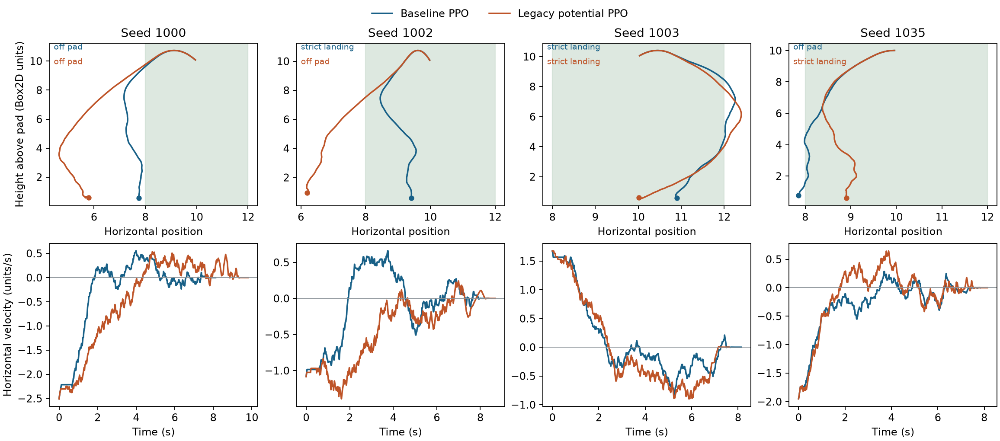
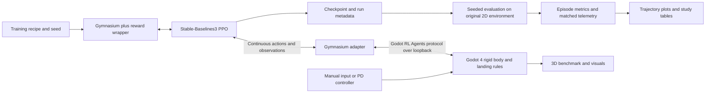

# RocketRL

RocketRL studies how PPO learns to land in two physics simulators. The 2D experiments use Gymnasium LunarLander and compare reward design on identical starting conditions. The custom Godot 4 environment adds continuous controls, a fuel budget, changing mass, and controlled disturbances for a separate 3D benchmark.

The ~1M-step baseline reproduced **54/100 strict landings** on the historical split and **47/100** on held-out initial seeds. Both historical reward variants finished below it on both splits. These are comparisons of four checkpoints from one training seed. In Godot, the initial PPO checkpoint landed **29/30 nominal trials** and **0/30 wind trials**. [Full results](docs/RESULTS.md) · [Nominal 3D demo](videos/godot-nominal.mp4) · [3D wind demo](videos/godot-wind.mp4)



## Install

From the repository root in PowerShell. The recorded 2D runs used Python 3.12.4 and the pinned dependencies.

```powershell
py -3.12 -m venv .venv
$py = ".\.venv\Scripts\python.exe"
& $py -m pip install -r requirements.txt
& $py -m unittest discover -v
```

## Reproduce the 2D results

```powershell
& $py -m lunar_lander.evaluate_metrics models/ppo_lunar_lander.zip --output artifacts/repro/early
& $py -m lunar_lander.record_trajectories models/ppo_lunar_lander_1m.zip --output artifacts/repro/baseline
& $py -m lunar_lander.evaluate_metrics models/ppo_precision_1m.zip --output artifacts/repro/precision
& $py -m lunar_lander.record_trajectories models/ppo_potential_1m.zip --output artifacts/repro/potential
& $py -m lunar_lander.plot_trajectories artifacts/repro/baseline artifacts/repro/potential artifacts/repro/diagnostics
& $py -m lunar_lander.training_curves runs artifacts/repro/training.png
```

Each evaluator writes episode CSV and summary JSON. With telemetry enabled, it writes a second CSV containing a reset sample and every transition. Default evaluation uses deterministic actions and seeds 1000–1099. Use `--seed-start 2000` and a new output directory for the held-out split. A strict landing requires a safe rest, an inclusive center-on-pad check, and contact from both legs. The leg flags describe contact with terrain. Engine-use cost uses the simulator's per-action penalties as a fuel proxy.

```powershell
& $py -m lunar_lander.train --reward potential --steps 1000000 --seed 42
& $py -m lunar_lander.continue_training
& $py -m lunar_lander.study artifacts/study-full --plan
& $py -m lunar_lander.study artifacts/study-pilot-repro --steps 20480
```

`train` defaults to 300k baseline steps. `train_precision` and `train_potential` are historical recipe entry points, with the latter using `potential-legacy`. The corrected recipe is `--reward potential`. Use a new output directory for each repeat. The full nine-run study is budgeted at roughly 3.5–5.6 CPU hours plus evaluation based on historical throughput. Remove `--plan` to run it.

## Run the Godot 4 simulation

Install the pinned transport package separately in the same environment, with `--no-deps`. Its released dependency metadata targets earlier Gymnasium and SB3 versions. RocketRL tested the protocol core from 0.8.2 with Gymnasium 1.4.0 and SB3 2.9.0 using its own Gymnasium adapter. Download the standard Godot 4.5.1 editor and set `$godot` to the absolute executable path. On Windows the console executable gives useful training logs. [Godot archive](https://godotengine.org/download/archive/4.5.1-stable/) · [Godot RL Agents 0.8.2](https://pypi.org/project/godot-rl/0.8.2/)

```powershell
& $py -m pip install --no-deps -r godot/requirements.txt
& $godot --path godot
& $py -m godot.check_simulation $godot
& $py -m godot.experiment evaluate $godot artifacts/3d-test --checkpoint models/ppo_godot_32768.zip
& $py -m godot.experiment train $godot artifacts/3d-train --steps 32768
```

Manual controls are Space for full throttle, Shift for partial throttle, WASD for the two gimbal axes, and R to reset. To watch a controller, add `--show-window --conditions nominal --episodes 1` to evaluation and choose a new output directory. The adapter starts Godot and connects over local loopback. The benchmark measures landing success, impact speed, pad error, terminal attitude, and fuel used. The 3D policy runs on a toy vehicle with an inner-loop attitude stabilizer and scripted wind.

## Architecture



- [Results, graphs, and limitations](docs/RESULTS.md)
- [Technical explanations](TECHNICAL_EXPLANATIONS.md)
- [Historical experiment log](PROJECT_PROGRESS.md)

**Résumé description.** Built and benchmarked PPO landing policies in Gymnasium and a custom Godot 4 rigid-body simulator. Reproduced four historical checkpoints, implemented paired trajectory diagnostics and seeded reward studies, and compared continuous-control PPO with a classical feedback controller across eight conditions.
