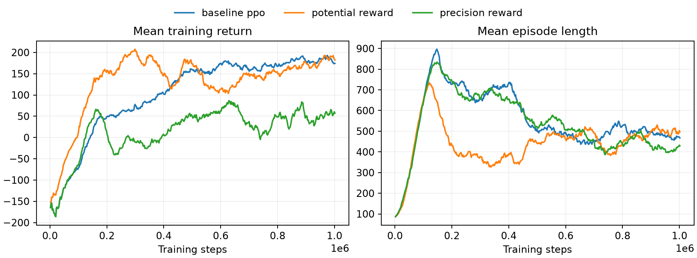
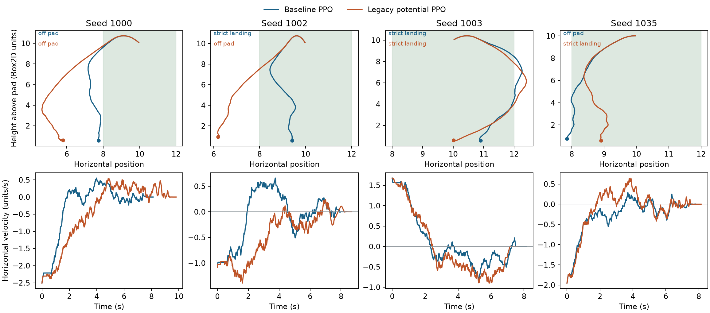
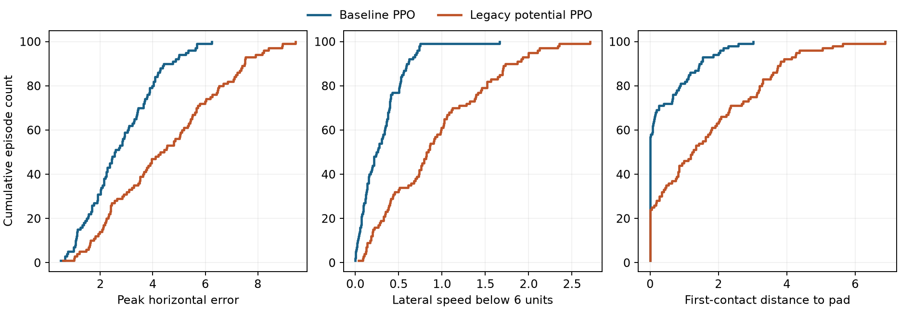
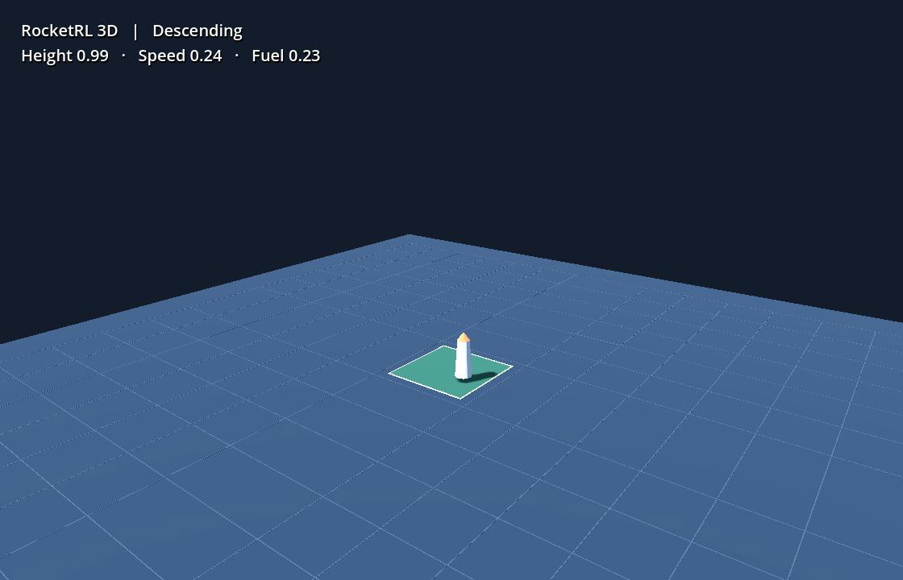

# RocketRL experiment results

## Checkpoint reproduction

All four retained LunarLander models were replayed in Gymnasium 1.4.0 with the original environment and deterministic actions. Each row reports mean episode return ± sample SD and two physical outcome rates over 100 episodes. The checkpoints use training seed 42. The long baseline continued the short baseline. The other two policies trained from scratch.

| Checkpoint | Actual steps | Seeds 1000–1099 return | Safe / strict | Seeds 2000–2099 return | Safe / strict |
| --- | ---: | ---: | ---: | ---: | ---: |
| Baseline PPO, early | 301,056 | 81.05 ± 117.58 | 60% / 16% | 87.16 ± 123.98 | 66% / 16% |
| Baseline PPO, continued | 1,001,472 | 198.27 ± 76.49 | 85% / 54% | 188.54 ± 84.20 | 80% / 47% |
| Terminal precision | 1,001,472 | 125.12 ± 110.77 | 70% / 16% | 124.20 ± 116.75 | 73% / 14% |
| Legacy potential | 1,001,472 | 157.57 ± 87.24 | 77% / 21% | 145.38 ± 97.09 | 73% / 28% |

These replays match historical returns and strict outcomes. The early checkpoint's safe-rest counts and the 2000-series split are new measurements. The longer baseline shows the highest original return and strict rate on both splits. The potential policy produced 54 safe off-pad rests on the historical split. Of these, 34 were on the left and 20 on the right, with a mean edge distance of 1.89 units, maximum 5.53, and 12 within 0.5 units. The baseline produced 24 with a mean edge distance of 0.90 units. The two splits sample the same simulator distribution. [Machine-readable checkpoint metrics](../results/reproduction/checkpoint-evaluations.csv)

The TensorBoard curves show training rewards under each policy's own reward function. The table uses a common evaluation reward. The plots span the original baseline training and its continuation.

## Matched trajectory analysis

The baseline and legacy potential policy were replayed on the same 100 historical seeds. The recorder verified common reset states and logs positions in Box2D units, then distinguished the first terrain contact from the final resting location.

| Metric | Continued baseline | Legacy potential |
| --- | ---: | ---: |
| Mean peak absolute center error | 2.77 | 4.49 |
| Mean absolute horizontal speed on descent at or below 6 units | 0.30 | 0.92 |
| Mean absolute horizontal speed one tick before contact | 0.32 | 0.50 |
| Mean downward speed one tick before contact | 0.87 | 0.71 |
| Mean center distance beyond pad at first contact | 0.41 | 1.66 |
| Median detected braking altitude | 9.78 (24/100 detected) | 8.38 (96/100 detected) |
| Mean action fractions (idle, left, main, right) | 40.2%, 7.1%, 46.8%, 5.9% | 11.5%, 19.9%, 45.2%, 23.5% |
| Episode ends (rest, body contact, time limit) | 85, 8, 7 | 77, 12, 11 |

The descent-speed measure samples the first descending, pre-contact frame at or below six units above pad height. First contact means a leg or body contact flag. The distance is zero when the center lies inside the pad's horizontal interval. The braking detector finds a descending, outward-moving, pre-contact sample with at least five side-engine actions in the previous ten steps and a reduction in absolute lateral speed of at least 0.25 units/s over ten steps. Its altitude measures where the window qualifies. Earlier maneuvers, continuous corrections, and primarily main-engine strategies can fall outside the detector.

For the legacy potential policy, off-pad safe rests had mean peak center error of 5.24 units and low-descent lateral speed of 1.09 units/s. Its strict landings averaged 2.21 units and 0.37 units/s. The baseline landed strictly on 54 seeds. The potential policy landed strictly on 15 of those and rested off pad on 27. Of the 24 baseline off-pad episodes, 2 became strict under the potential policy. Excess lateral motion is consistent with weaker position correction, including the behavior shown at seed 1002. The much higher side-engine usage points to a difference in control strategy. Unequal detector coverage and single-training-seed comparisons limit any claim about late braking or causal effects of the reward. [Episode diagnostics](../results/reproduction/trajectory-episodes.csv) · [Paired outcomes](../results/reproduction/paired-outcomes.csv) · [Outcome summaries](../results/reproduction/trajectory-by-outcome.csv) · [Termination counts](../results/reproduction/termination-reasons.csv)

## Multi-seed 2D pilot

Three recipes each trained at seeds 42, 43, and 44 for 20,480 steps from scratch. Each policy ran 100 deterministic episodes on each of the two fixed evaluation splits. Every policy had zero safe rests and zero strict landings on both splits. Mean return variation across training seeds was large even at this short budget.

| Recipe | Historical mean return ± training-seed SD | Held-out mean return ± training-seed SD | Historical mean engine-use cost |
| --- | ---: | ---: | ---: |
| Baseline | −829 ± 343 | −820 ± 345 | 54.44 |
| Corrected potential | −1,443 ± 1,742 | −1,421 ± 1,703 | 83.74 |
| Explicit landing objective | −815 ± 502 | −779 ± 486 | 49.45 |

The explicit objective's lower observed engine-use cost occurred alongside zero safe rests. Efficiency claims require conditioning on successful control and inspecting episode length and termination. This budget tests the workflow and early behavior. The million-step matched study remains pending. The supplied bootstrap intervals resample independent training runs, and the paired contrasts use matching training seed IDs. With only three seeds, a degenerate interval for all-zero outcomes reflects the sample. [Pilot per-seed results](../results/reproduction/pilot-runs.csv) · [Pilot aggregate statistics](../results/reproduction/pilot-aggregates.csv) · [Paired recipe differences](../results/reproduction/pilot-paired-differences.csv)

## Custom Godot 4 benchmark

PPO trained for 32,768 control decisions from seed 42 in nominal conditions, taking 195 seconds on CPU. The two controllers ran the same 30 test seeds, 3000–3029, per condition. The classical proportional-derivative controller uses gravity compensation and the simulator-provided wind vector. Both controllers can observe the wind. PPO training used zero wind. The three-action policy controls throttle and two directions of the thrust vector while a fixed inner-loop stabilizer holds attitude.

| Test condition | PPO / PD landings | PPO / PD mean center error | PPO / PD mean fuel used |
| --- | ---: | ---: | ---: |
| Nominal | 29 / 30 | 1.14 / 0.22 | 0.195 / 0.116 |
| Higher start (+3 vertical units) | 26 / 30 | 1.19 / 0.04 | 0.204 / 0.182 |
| Wider start (2× offset) | 20 / 30 | 1.60 / 0.47 | 0.192 / 0.117 |
| Faster start (1.7× velocity) | 28 / 30 | 1.16 / 0.25 | 0.198 / 0.115 |
| Heavier body (+0.30 mass) | 29 / 30 | 0.86 / 0.22 | 0.154 / 0.141 |
| Reduced thrust (0.8×) | 24 / 30 | 1.01 / 0.22 | 0.139 / 0.144 |
| Wind (0.65 force, seeded heading) | 0 / 30 | 4.85 / 0.22 | 0.204 / 0.118 |
| Reduced fuel (0.55×) | 29 / 30 | 1.13 / 0.22 | 0.170 / 0.101 |

The landing classifier checks whether the center is over the pad at first contact, horizontal and vertical pre-impact speeds are at most 0.75 and 1.15, the up-vector dot product is at least 0.966, and angular speed is at most 0.8. Mean center error and fuel include all attempts. Nominal PPO touched down at mean speed 0.31 compared with 0.51 for PD, while using about 67% more fuel and landing farther from the center. Under wind, the PPO checkpoint recorded 29 off-pad contacts and one hard contact. The classical controller's advantage pertains to the tested simulator and conditions. Physics fidelity, joint disturbances, and robustness across independently trained 3D policies remain open. [Benchmark summaries](../results/reproduction/godot-benchmark-summary.json) · [Benchmark episode data](../results/reproduction/godot-benchmark-episodes.csv) · [Initial 3D checkpoint](../models/ppo_godot_32768.zip)

## Demonstrations

- [Godot nominal landing, seed 3000](../videos/godot-nominal.mp4)
- [Godot wind-driven off-pad contact, seed 3000](../videos/godot-wind.mp4)
- [LunarLander strict landing, seed 1056](../videos/seed-1056.mp4)
- [LunarLander body contact, seed 1032](../videos/seed-1032.mp4)

Recreate the 2D clips using `python -m lunar_lander.demo models/ppo_lunar_lander_1m.zip artifacts/new-clips --seeds 1056 1032` with FFmpeg on PATH. On headless Windows or Linux, set `SDL_VIDEODRIVER=dummy` before recording.

For Godot, use a new evaluation directory and add `--checkpoint models/ppo_godot_32768.zip --skip-pd --conditions nominal --episodes 1 --seed-start 3000 --movie artifacts/nominal.avi` to the evaluation command. Use `wind` and a new movie filename for the second scenario. Godot records an AVI at 60 fps. The published clips were transcoded to H.264 with FFmpeg.
